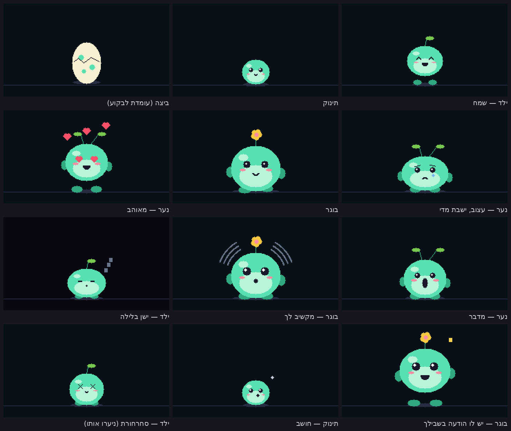
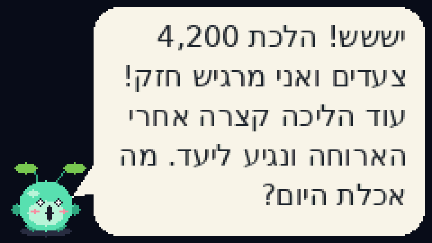

# 🥚 פיפו: חיית מחמד דיגיטלית שהיא גם המאמן האישי שלך

מכשיר קטן שתולים על מחזיק המפתחות. גר בו פיפו, יצור ירוק קטן שבוקע מביצה וגדל מהצעדים שלך.
הוא שמח כשאתה זז, נעצב כשאתה יושב יותר מדי, ישן בלילה ומבקש ממך לקום ולזוז.
הוא גם המאמן האישי שלך: מחזיקים את הכפתור, מדברים, והוא עונה בקול ובבועת דיבור בעברית.





## מה להזמין
**M5Stack StickS3** (דגם K150). בחנות של M5Stack או ב-AliExpress, בערך $21.50.
יש בו מסך צבעוני 1.14", מיקרופון, רמקול, חיישן תנועה (לספירת צעדים), שני כפתורים, סוללה, USB-C וחור לרצועה.
ההכנה היחידה היא צריבת התוכנה. אין צורך בהלחמה.

## איך משחקים
| פעולה | מה קורה |
|---|---|
| **מחזיקים את הכפתור הגדול** | פיפו מקשיב. מדברים ועוזבים, והוא חושב ועונה בקול |
| **לחיצה קצרה על הכפתור הגדול** | מלטפים אותו ❤️ (או מעבירים לעמוד הבא בבועה / סוגרים אותה) |
| **הכפתור בצד** | כרטיס מצב: שם, שלב, צעדים היום וניסיון |
| **ניעור** | פיפו מקבל סחרחורת 😵 |
| **הרמה מהשולחן** | המסך נדלק |
| **צפצוף** | יש לו משהו להגיד: תזכורת, צ'ק-אין בוקר/ערב, או "בוא נזוז!" |

### איך הוא גדל
ניסיון: נקודה על כל 100 צעדים, 25 על כל אימון שסיפרת לו, ו-2 על כל שיחה.
**ביצה** (0), **תינוק** (30), **ילד** (300), **נער** (1,200), **בוגר** (3,000). כשהוא גדל יש מסיבה קטנה עם מנגינה.
פס הצעדים בתחתית המסך מראה כמה הלכת היום מתוך היעד.
אפשר לתת לו שם אחר: פשוט אומרים לו "מעכשיו קוראים לך..."

## צריבה
1. מתקינים [VS Code](https://code.visualstudio.com/) ואת התוסף **PlatformIO**.
2. פותחים את התיקייה `pet/`.
3. מעתיקים את `src/config.example.h` ל-`src/config.h` וממלאים: רשתות WiFi (בית ונקודה חמה בטלפון), כתובת השרת ו-`DEVICE_KEY`.
4. מחברים ב-USB-C ולוחצים **Upload**. מהשורה:
```bash
cd pet && pio run -t upload
```
הבנייה הראשונה מורידה בערך 1GB של כלים.

## כדאי לדעת
- **סוללה:** הסוללה קטנה (250mAh), אז מדובר בשעות, לא בימים. זו הערכה שלא מדדתי. המסך כבה אחרי 30 שניות, ובבית כדאי להשאיר אותו בטעינה כמו בעמדה.
- **אינטרנט:** WiFi בלבד, בתדר 2.4GHz. בחוץ הוא מתחבר לנקודה חמה בטלפון. בלי חיבור פיפו עדיין חי וסופר צעדים, ונקודה אדומה בפינה מראה שאין רשת.
- **צעדים:** הספירה נעשית במכשיר. צריך כמה צעדים ברצף כדי שהוא יתחיל לספור, וכך נענוע ביד לא נחשב. הדיוק הכי טוב כשהמכשיר בכיס או על התיק.
- כל ה"מוח" (זיהוי דיבור, Claude, הקול העברי וציור הבועות) יושב בשרת `coach/`.
